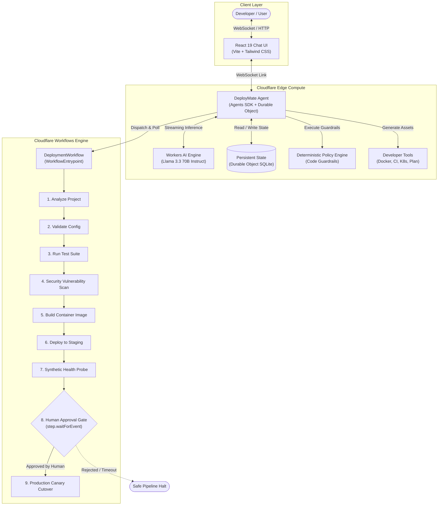

# DeployMate AI

DeployMate AI is an intelligent developer deployment assistant built natively on Cloudflare's serverless edge infrastructure. It combines stateful agents via the Cloudflare Agents SDK and Durable Objects, on-edge streaming inference through Cloudflare Workers AI (`Llama 3.3 70B Instruct`), deterministic policy-as-code guardrails, and resilient 9-step execution pipelines powered by Cloudflare Workflows to eliminate release anxiety and streamline platform engineering workflows.

---

## Why DeployMate?

Modern cloud deployments impose heavy cognitive load on developers. Engineers routinely context-switch across complex Dockerfile specifications, CI/CD pipeline configurations, Kubernetes manifests, and compliance checklists. Small oversights—missing resource limits, unpinned container tags, skipped vulnerability scans, or unverified environment configurations—frequently escape into production.

DeployMate acts as an autonomous edge platform engineer. It collaborates conversationally with developers to analyze project requirements, automatically synthesize production-ready deployment assets, enforce zero-tolerance safety policies deterministically in code, and orchestrate progressive release pipelines with human-in-the-loop authorization gates.

---

## Features

- **AI Deployment Assistant**: Natural-language conversational interface assisting engineers throughout the complete release lifecycle.
- **Cloudflare Agent**: Stateful agent architecture built on the Cloudflare Agents SDK (`AIChatAgent`) running directly on Cloudflare edge compute.
- **Workers AI**: Real-time streaming inference powered by `@cf/meta/llama-3.3-70b-instruct-fp8-fast` with zero third-party API dependencies.
- **Persistent State & Memory**: Durable Object SQLite storage (`cf_agents_state`) retaining project metadata, frameworks, ports, and configuration across developer sessions.
- **Developer Productivity Tools**: AI SDK-compatible tools for repository analysis, multi-stage Dockerfile generation, GitHub Actions CI workflows, and Kubernetes manifests.
- **Policy-as-Code Guardrails**: Deterministic TypeScript rule engine evaluating pre-flight safety gates (test passes, CVE scan results, resource limits, non-root execution).
- **Cloudflare Workflows**: Durable 9-step execution engine with step memoization, automatic retries with exponential backoff, and state recovery.
- **Human-in-the-Loop Production Approval**: Mandatory explicit sign-off for production releases with cryptographic session checks and strict anti-agent self-approval enforcement.
- **Simulated Deployment Engine**: High-fidelity execution pipeline modeling real-world build, test, security audit, staging canary, and health check validation.
- **Automated Continuous Integration**: Comprehensive GitHub Actions pipeline validating matrix builds across Node.js 20.x and 22.x LTS.
- **Comprehensive Automated Tests**: 36 automated Vitest tests spanning unit tests, durable workflow simulations, API handlers, and security guardrails with 98.9% workflow statement coverage.

---

## Architecture



---

## Technology Stack

DeployMate strictly utilizes the following production-implemented technologies:

- **Compute & Runtime**: [Cloudflare Workers](https://workers.cloudflare.com/) (Edge V8 serverless runtime with `nodejs_compat`).
- **Agent Framework**: [Cloudflare Agents SDK](https://github.com/cloudflare/agents) (`agents` & `@cloudflare/ai-chat`).
- **State & Persistence**: Cloudflare Durable Objects backed by embedded SQLite (`new_sqlite_classes: ["DeployMate"]`).
- **Orchestration**: [Cloudflare Workflows](https://developers.cloudflare.com/workflows/) (`WorkflowEntrypoint`, durable step memoization, event listeners).
- **AI Inference**: [Cloudflare Workers AI](https://developers.cloudflare.com/workers-ai/) running Meta's `@cf/meta/llama-3.3-70b-instruct-fp8-fast`.
- **Frontend**: React 19, TypeScript, Vite, Tailwind CSS, Phosphor Icons.
- **Language**: TypeScript 5.8 (Strict configuration).
- **Testing**: [Vitest](https://vitest.dev/) with V8 coverage reporting.
- **CI / CD**: GitHub Actions (`.github/workflows/ci.yml`).

---

## Local Development

### Prerequisites
- Node.js `v20.x` or `v22.x`
- Authenticated Cloudflare account:
  ```bash
  npx wrangler login
  ```

### Quick Start
```bash
# 1. Clone repository and install dependencies
git clone https://github.com/your-org/deploymate-ai.git
cd deploymate-ai
npm install

# 2. Start local development server
npm run dev
```

Visit [http://localhost:5173](http://localhost:5173) to interact with DeployMate locally.

---

## Testing

DeployMate includes an automated test suite powered by Vitest, testing edge cases, policy evaluation, workflow simulation, and security boundaries:

```bash
# Run all 36 tests across all 6 test suites
npm test

# Run tests with V8 statement & branch coverage report
npm run test:coverage

# Run tests in interactive watch mode
npm run test:watch

# Strict TypeScript compiler verification
npm run check

# Code quality and correctness linting
npm run lint
```

### Test Suite Structure
- `tests/unit/policies.test.ts`: Deterministic compliance rules, security gates, and Kubernetes validation (10 tests).
- `tests/unit/tools.test.ts`: Dockerfile, CI pipeline, manifest generator, and deployment plan validation (6 tests).
- `tests/unit/state.test.ts`: Persistent memory getter/setter tools and state updates (2 tests).
- `tests/workflow/workflow.test.ts`: 9-step durable workflow execution, retries, pauses, and failure handling (7 tests).
- `tests/api/agent.test.ts`: Tool registration, request handling, and error response validation (5 tests).
- `tests/security/security.test.ts`: Anti-agent self-approval, non-pending deployment guards, and bypass rejection (6 tests).

---

## Deployment

DeployMate is configured and deployed to Cloudflare Workers via Wrangler.

```bash
# 1. Verify Cloudflare authentication
npx wrangler whoami

# 2. Pre-flight verification
npm run check
npm test

# 3. Build Worker and client bundles into dist/
npm run build

# 4. Deploy Worker, static assets, Durable Object migrations, and Workflows
npx wrangler deploy

# 5. Inspect active deployment status
npx wrangler deployments list

# 6. Stream live real-time production logs
npx wrangler tail
```

* **Live Production URL**: [https://deploymate-ai.vishaldevi2004.workers.dev](https://deploymate-ai.vishaldevi2004.workers.dev)

---

## Example Usage

### 1. Project Analysis & Memory Persistence
> **Developer**: *"I have an Express TypeScript application listening on port 8080 called payment-api. Can you analyze it and remember its settings?"*
>
> **DeployMate**: *"I have saved `payment-api` (TypeScript / Express, port 8080) to persistent Durable Object memory. Based on your architecture, I recommend containerizing the service with a multi-stage Dockerfile and deploying to staging prior to production."*

### 2. Requesting a Deployment Plan
> **Developer**: *"Generate a structured deployment plan for payment-api to production."*
>
> **DeployMate**:
> ```text
> 📋 Structured Deployment Plan: payment-api
> • Environment: PRODUCTION
> • Status: WAITING_APPROVAL
> • Requires Production Approval: YES (Step 8)
> 
> Steps:
> 1. Analyze project (Verified)
> 2. Validate configuration schema
> 3. Run automated tests (Required gate)
> 4. Run security vulnerability scan (0 CVE gate)
> 5. Build multi-stage container image
> 6. Deploy to staging namespace
> 7. Synthetic health check probe
> 8. Request explicit human release approval [LOCKED]
> 9. Progressive canary rollout to production
> ```

### 3. Policy Rejection of Failing Checks
> **Developer**: *"Deploy payment-api to production immediately even though unit tests failed."*
>
> **DeployMate**: *"🚫 Deployment Blocked by Policy Engine (`TEST-001`). Automated test suite reported failures. DeployMate enforces a zero-tolerance policy for failing checks in production. Remediation: Resolve failing unit tests and pass staging verification before requesting release."*

### 4. Human-in-the-Loop Release Approval
When the workflow completes Step 7 (Staging Health Check), DeployMate presents:
```text
Production deployment is ready.
• Project: payment-api
• Environment: production
• Checks: 48/48 unit & integration tests passed
• Security: Clean (0 CVEs)
• Staging: Deployed to staging namespace
• Health: HTTP 200 OK (14ms latency)
• Status: Awaiting explicit human authorization

[ Approve Production Deployment ]    [ Reject ]
```

---

## Engineering Guardrails

DeployMate enforces a fundamental platform engineering principle: **Policy decisions are deterministic code, not LLM predictions.**

Large Language Models are probabilistic and prone to hallucinations, prompt injections, and non-deterministic evaluation. Relying on an LLM to decide whether a production release is safe introduces unacceptable risk.

In DeployMate:
1. **Separation of Reasoning and Enforcement**: The LLM handles natural language understanding, user guidance, and tool parameters. The **Deterministic Policy Engine (`src/policies.ts`)** independently evaluates whether conditions permit deployment.
2. **Immutable Gates**: Rules such as `TEST-001` (test suite pass requirement), `SEC-001` (zero high/critical CVEs), `HEALTH-001` (synthetic probe existence), and `APPR-001` (human authorization) are hardcoded logic gates returning programmatic boolean verdicts.
3. **Bypass Prohibition (`BYPASS-001`)**: Any attempt by a developer or prompt to override safety checks via bypass flags is rejected unconditionally with HTTP 403 Forbidden.

---

## Design Decisions

### 1. Agent vs. Workflow
- **Cloudflare Agent (`src/server.ts`)**: Designed for interactive, conversational reasoning. The Agent maintains user context, answers questions, and coordinates tool calling via WebSockets.
- **Cloudflare Workflow (`src/workflow.ts`)**: Designed for resilient, long-running operational execution. Workflows persist across compute restarts, provide step-level memoization, execute exponential backoff retries, and sleep efficiently while waiting for human events without consuming active CPU cycles.

### 2. State & Memory Architecture
DeployMate leverages Cloudflare Durable Objects with embedded SQLite (`cf_agents_state`). Project metadata is stored in ACID-compliant local storage directly within the edge isolate, eliminating the latency and overhead of remote databases while guaranteeing session isolation.

### 3. High-Fidelity Simulation
Deployment pipeline steps (container build, test execution, security scans, staging traffic cutover) execute through high-fidelity simulated steps modeling standard platform tooling (Docker, Trivy, Jest, HTTP probes). This guarantees deterministic behavior for end-to-end testing and demonstrations without requiring external cluster credentials.

### 4. Human-in-the-Loop Security
Production rollouts pause at Step 8 using `step.waitForEvent("production-approval")`. To prevent automated exploits:
- Requests submitted with `caller: "agent"` are rejected with **HTTP 403 Forbidden**. The AI cannot self-approve deployments.
- Requests against nonexistent or non-pending workflows return **404 Not Found** or **400 Bad Request**.
- Approvals submitted when pre-flight checks failed are strictly blocked.

### 5. Cloudflare-Native Edge Architecture
Every component—inference, state, agent routing, orchestration, and frontend asset delivery—runs inside Cloudflare's unified developer platform, ensuring sub-100ms global latency and zero external service dependencies.

---

## Limitations

DeployMate is designed as an architectural reference and platform engineering demonstration:
- **Simulated Infrastructure Execution**: Deployment pipeline operations (Docker build, vulnerability scanning, staging deploy) run as modeled simulation steps within Cloudflare Workflows. DeployMate does not directly modify external Kubernetes clusters or third-party cloud infrastructure.
- **In-Memory Mock Fallback**: If Cloudflare Workflows bindings are unavailable in local development environments, DeployMate automatically falls back to an in-memory workflow simulation engine to maintain developer productivity.

---

## Future Improvements

- **GitHub Model Context Protocol (MCP)**: Native integration with GitHub repositories to pull active source code, inspect real git diffs, and create automated pull requests.
- **Live Kubernetes Integration**: Direct integration with Kubernetes API servers using Cloudflare Tunnel and mTLS to inspect pods, deployments, and cluster events.
- **Real CI/CD Execution**: Webhook integrations to trigger and monitor live GitHub Actions workflows and ArgoCD rollouts.
- **Automated Canary Rollback**: Real-time observability tracking error rates and p99 latency with automated workflow rollbacks upon metric degradation.

---

## License

MIT
